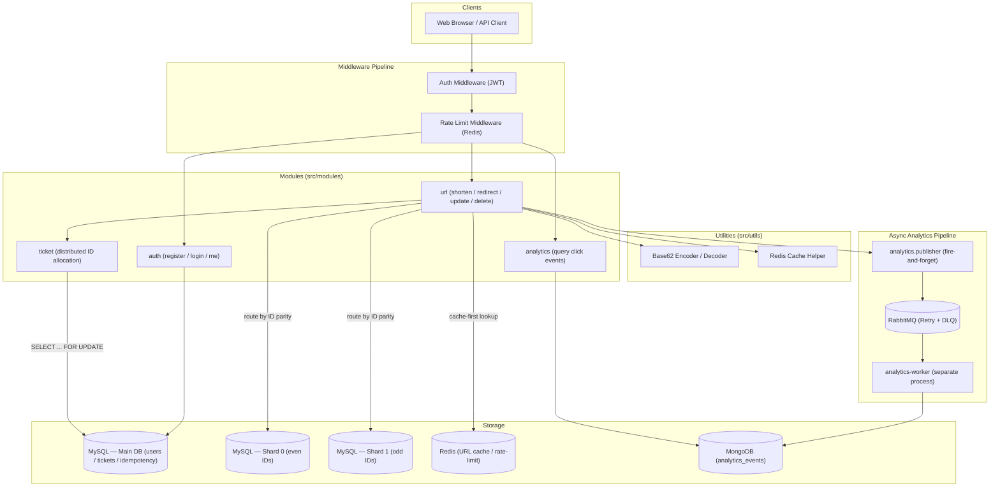

# URL Shortener

> *A distributed, high-performance URL shortener built for scale.*

A production-grade URL shortening service built with **TypeScript**, **Express.js**, **Prisma ORM**, **MySQL** (with horizontal sharding), **Redis**, **RabbitMQ**, and **MongoDB**. The architecture separates concerns cleanly across modules and decouples analytics ingestion from the hot redirect path using an async message queue.

---

## Architecture Overview



---

## Key Design Decisions

### Short Code Generation — Base62 over a Distributed Ticket Server

Rather than generating random codes and checking for collisions, the service uses a **Ticket Server** pattern backed by MySQL for coordination. Each URL gets a globally unique `bigint` ID allocated under a `SELECT … FOR UPDATE` transaction, which is then encoded to a compact **Base62** string (using the alphabet `a-z A-Z 0-9`). Decoding the short code recovers the exact ID in O(1) — no database lookup for the ID itself is needed, only a shard route.

```text
ticket (bigint) ──→ Base62 encode ──→ shortCode (e.g. "3aKx")
shortCode        ──→ Base62 decode ──→ ticket  ──→ shard router ──→ MySQL shard
```

### Horizontal Database Sharding

URLs are stored across **two MySQL shards** routed by ID parity:

| Shard   | Contains            |
|---------|---------------------|
| Shard 0 | URLs with even IDs  |
| Shard 1 | URLs with odd IDs   |

The **main database** (`url_shortener`) holds non-URL data: users, ticket server state, and idempotency keys. Shard selection is deterministic and requires no lookup table.

### Cache-First Redirect

On `GET /:shortCode`, the service checks **Redis** before hitting a shard:

1. **Cache HIT** → return `originalUrl` immediately (includes expiry validation).
2. **Cache MISS** → decode short code → route to shard → query MySQL → populate Redis (TTL: 1 h) → redirect.
3. **Redis unavailable** → fail open, query MySQL directly.

### Idempotent URL Creation

`POST /api/urls` accepts an optional `Idempotency-Key` header. Duplicate requests with the same key and identical body return the original response without creating a second URL. Conflicting payloads receive `409 Conflict`.

### Async Analytics via RabbitMQ

The redirect handler publishes a `UrlRedirectEvent` to RabbitMQ **after** sending the `301` response — it never blocks the redirect. A **separate worker process** consumes events, parses the User-Agent (browser, OS, device) with `ua-parser-js`, anonymizes the IP address (last IPv4 octet zeroed, last 64 bits of IPv6 cleared), and persists the record to MongoDB.

The queue topology includes a **retry exchange** (5 s delay, up to 3 retries) and a **dead-letter queue** for events that exhaust all retries.

```text
url.analytics (exchange)
    └─→ url.analytics.queue          ← worker consumes here
            │ nack (fail)
            └─→ url.analytics.retry (exchange)
                    └─→ url.analytics.retry.queue  ← TTL 5 s
                            │ TTL expires
                            └─→ url.analytics (exchange)  ← re-queued
                                    │ > 3 retries
                                    └─→ url.analytics.dlx (exchange)
                                            └─→ url.analytics.dlq  ← dead letters
```

### Rate Limiting

URL creation is rate-limited per authenticated user using **Redis counters**:

- **10 requests / 60 seconds** per user.
- Fails open if Redis is unavailable (creation is never blocked by a Redis outage).

---

## Project Structure

```text
src/
├── app.ts                        # Express app + route mounting
├── server.ts                     # HTTP server bootstrap
├── analytics-worker.ts           # Worker process entry point
│
├── config/
│   ├── env.ts                    # Validated environment variables
│   ├── redis.ts                  # Redis client
│   ├── rabbitmq.ts               # RabbitMQ connection + topology setup
│   └── mongodb.ts                # MongoDB connection
│
├── db/
│   ├── prisma.ts                 # Main Prisma client (users, tickets, idempotency)
│   ├── shard0.ts                 # Prisma client — Shard 0
│   ├── shard1.ts                 # Prisma client — Shard 1
│   └── shard-router.ts           # ID-parity shard selector
│
├── middleware/
│   ├── auth.middleware.ts         # JWT verification → req.userId
│   └── rate-limit.middleware.ts   # Redis-backed per-user rate limiter
│
├── modules/
│   ├── auth/
│   │   ├── auth.routes.ts         # POST /register, POST /login, GET /me
│   │   ├── auth.controller.ts
│   │   ├── auth.service.ts        # Register / login business logic
│   │   ├── auth.schema.ts         # Zod validation schemas
│   │   ├── jwt.ts                 # JWT sign / verify helpers
│   │   └── password.ts            # bcrypt hash / compare
│   │
│   ├── url/
│   │   ├── url.routes.ts          # POST /, PATCH /:code, DELETE /:code
│   │   ├── url.controller.ts      # HTTP handlers + redirect controller
│   │   ├── url.service.ts         # Core URL CRUD + cache logic
│   │   └── url.schema.ts          # Zod validation schemas
│   │
│   ├── analytics/
│   │   ├── analytics.route.ts     # GET /api/analytics/:shortCode
│   │   ├── analytics.controller.ts
│   │   ├── analytics.service.ts   # MongoDB query logic
│   │   ├── analytics.model.ts     # Mongoose schema (analyticsevents)
│   │   ├── analytics.publisher.ts # RabbitMQ publish helper
│   │   └── analytics.worker.ts    # Consumer: parse UA, anonymize IP, persist
│   │
│   └── ticket/
│       └── ticket.service.ts      # allocateTicket() — SELECT … FOR UPDATE
│
└── utils/
    ├── encoder.ts                 # Base62 encode / decode (bigint ↔ string)
    └── cache.ts                   # invalidateUrlCache helper
```

---

## Data Models

### Main Database (MySQL — Prisma)

| Table             | Purpose                                                            |
|-------------------|--------------------------------------------------------------------|
| `User`            | Registered users (email + bcrypt password hash)                    |
| `TicketServer`    | Named ticket server instances (ACTIVE / INACTIVE)                  |
| `TicketRange`     | Pre-allocated ID ranges assigned to a ticket server                |
| `IdempotencyKey`  | Deduplication records keyed by `(userId, key)`                     |

### URL Shards (MySQL — Prisma, × 2)

| Table | Purpose                                                          |
|-------|------------------------------------------------------------------|
| `Url` | Short codes, original URLs, owner, expiry, soft-delete timestamp |

Indexes: `shortCode` (unique), `userId`, `expiresAt`.

### Analytics (MongoDB — Mongoose)

| Collection        | Purpose                                                           |
|-------------------|-------------------------------------------------------------------|
| `analyticsevents` | Per-redirect events: browser, OS, device, anonymized IP, referrer |

Compound indexes: `(shortCode, timestamp desc)`, `(shortCode, ip)`.

---

## API Reference

### Auth — `/api/auth`

| Method | Path        | Auth | Description        |
|--------|-------------|------|--------------------|
| `POST` | `/register` | ✗    | Create account     |
| `POST` | `/login`    | ✗    | Obtain JWT         |
| `GET`  | `/me`       | ✓    | Fetch own profile  |

### URLs — `/api/urls`

| Method   | Path          | Auth | Description                                            |
|----------|---------------|------|--------------------------------------------------------|
| `POST`   | `/`           | ✓    | Shorten a URL (supports `Idempotency-Key` header)      |
| `PATCH`  | `/:shortCode` | ✓    | Update original URL or expiry                          |
| `DELETE` | `/:shortCode` | ✓    | Soft-delete a short URL                                |

### Redirect

| Method | Path          | Auth | Description                                            |
|--------|---------------|------|--------------------------------------------------------|
| `GET`  | `/:shortCode` | ✗    | Resolve and redirect (301); publishes analytics event  |

### Analytics — `/api/analytics`

| Method | Path          | Auth | Description                             |
|--------|---------------|------|-----------------------------------------|
| `GET`  | `/:shortCode` | ✓    | Fetch click analytics for a short code  |

### Health

| Method | Path      | Auth | Description             |
|--------|-----------|------|-------------------------|
| `GET`  | `/health` | ✗    | Service liveness check  |

---

## Getting Started

### Prerequisites

- Node.js ≥ 20
- MySQL (3 instances: main + 2 shards)
- Redis
- RabbitMQ
- MongoDB

### Installation

```bash
# Install dependencies
npm install

# Copy and fill in environment variables
cp .env.example .env
```

### Environment Variables

| Variable                                               | Description                                  |
|--------------------------------------------------------|----------------------------------------------|
| `PORT`                                                 | Express server port                          |
| `DATABASE_URL`                                         | Main MySQL connection string                 |
| `SHARD_0_DATABASE_URL`                                 | Shard 0 MySQL connection string              |
| `SHARD_1_DATABASE_URL`                                 | Shard 1 MySQL connection string              |
| `DATABASE_HOST/USER/PASSWORD/NAME`                     | Main DB credentials (used by Prisma adapter) |
| `SHARD_{0,1}_DATABASE_{HOST,PORT,USER,PASSWORD,NAME}`  | Per-shard credentials                        |
| `JWT_SECRET`                                           | HMAC secret for JWT signing                  |
| `JWT_EXPIRES_IN_SECONDS`                               | Token lifetime in seconds                    |
| `REDIS_URL`                                            | Redis connection URL                         |
| `RABBITMQ_URL`                                         | RabbitMQ AMQP URL                            |
| `MONGODB_URL`                                          | MongoDB connection string                    |
| `MONGODB_DATABASE`                                     | MongoDB database name                        |

### Database Setup

```bash
# Generate Prisma clients for all schemas
npm run prisma:generate

# Run migrations (main DB)
npx prisma migrate deploy --schema=prisma/schema.prisma

# Run migrations (shard 0)
npx prisma migrate deploy --schema=prisma-shards/shard-0/schema.prisma

# Run migrations (shard 1)
npx prisma migrate deploy --schema=prisma-shards/shard-1/schema.prisma

# Seed ticket server data
npx tsx prisma/seed.ts
```

### Running

```bash
# Development — app (hot reload)
npm run dev

# Development — analytics worker (hot reload, separate terminal)
npm run worker

# Production
npm run build
npm run start
npm run worker:start
```

### Testing

```bash
# Unit tests
npm test

# Watch mode
npm run test:watch

# End-to-end endpoint tests
npm run test:e2e
```

### Linting & Type Checking

```bash
npm run typecheck
npm run lint
```

---

## Dependencies

### Runtime

| Package                                                                          | Purpose                                                |
|----------------------------------------------------------------------------------|--------------------------------------------------------|
| [express](https://www.npmjs.com/package/express)                                 | HTTP server and routing framework                      |
| [@prisma/client](https://www.npmjs.com/package/@prisma/client)                   | Type-safe ORM for MySQL (main DB + shards)             |
| [@prisma/adapter-mariadb](https://www.npmjs.com/package/@prisma/adapter-mariadb) | MariaDB/MySQL driver adapter for Prisma                |
| [redis](https://www.npmjs.com/package/redis)                                     | Redis client for caching and rate limiting             |
| [amqplib](https://www.npmjs.com/package/amqplib)                                 | RabbitMQ AMQP client for the async analytics pipeline  |
| [mongoose](https://www.npmjs.com/package/mongoose)                               | MongoDB ODM for analytics event persistence            |
| [mongodb](https://www.npmjs.com/package/mongodb)                                 | MongoDB native driver                                  |
| [jsonwebtoken](https://www.npmjs.com/package/jsonwebtoken)                       | JWT signing and verification                           |
| [bcrypt](https://www.npmjs.com/package/bcrypt)                                   | Password hashing                                       |
| [ua-parser-js](https://www.npmjs.com/package/ua-parser-js)                       | User-Agent parsing (browser, OS, device)               |
| [zod](https://www.npmjs.com/package/zod)                                         | Runtime schema validation for request bodies           |
| [dotenv](https://www.npmjs.com/package/dotenv)                                   | Environment variable loading                           |

### Development

| Package                                                | Purpose                                       |
|--------------------------------------------------------|-----------------------------------------------|
| [typescript](https://www.npmjs.com/package/typescript) | Static typing                                 |
| [tsx](https://www.npmjs.com/package/tsx)               | TypeScript execution for development          |
| [prisma](https://www.npmjs.com/package/prisma)         | Prisma CLI for migrations and code generation |
| [vitest](https://www.npmjs.com/package/vitest)         | Fast unit test runner                         |
| [eslint](https://www.npmjs.com/package/eslint)         | Linting                                       |
